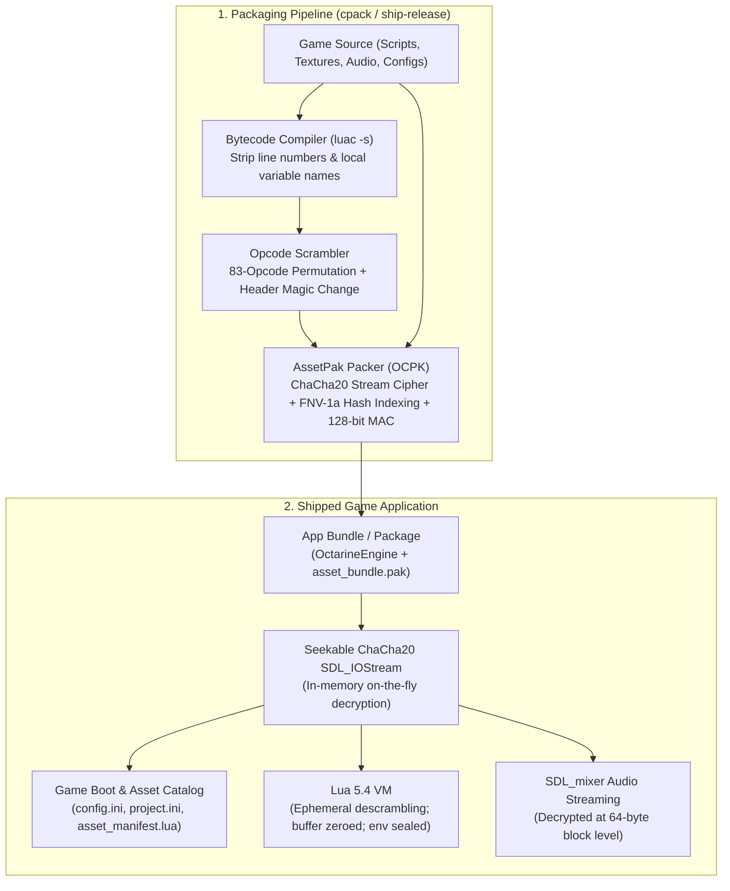

# Game Security & Asset Protection

Octarine Engine provides automated, multi-layered security hardening for shipped games. Its goal is to protect indie developers against automated asset ripping, Lua script decompilation (`unluac`, `luadec`), dynamic runtime hooks, and low-effort clone farms—all without introducing friction or slowdown during daily development.

---

## 1. Overview & Threat Model

Commercial indie games built with scripting languages and loose assets are frequent targets for extraction and decompilation:
- **Asset Ripping**: Tools scrape textures, sprites, audio tracks, and fonts from loose folders or standard unencrypted archives (ZIP, TAR).
- **Bytecode Decompilation**: Public decompilers can reverse standard compiled Lua 5.4 bytecode back into readable Lua source code if debug symbols and standard opcodes are intact.
- **Save & Script Modification / Cheating**: Players or modders inject modified `.lua` scripts or replace runtime configs to alter game logic, unlock features, or bypass game rules.
- **Dynamic Inspection & Hooking**: Reverse engineers attach tools like Frida or Cheat Engine to hook standard exported C/Lua functions (`luaL_loadbufferx`, `SDL_LoadFile`) or monitor process memory to dump decrypted scripts.

### Octarine Design Principles
1. **Zero Development Friction**: In development builds (`player-debug`, `player-release`), files stay 100% loose and unencrypted on disk. Hot-reloading, live file watching, and interactive debugging function normally.
2. **Automated Shipping Hardening**: When building with `ship-release` or packaging via CPack, the engine automatically compiles bytecode, scrambles opcodes, encrypts all assets into an `OCPK` archive, and strips binary symbols.
3. **No Plaintext Temp Files or In-Memory Clones**: Assets and audio streams decrypt on the fly directly in memory. The entire decrypted archive is never dumped to disk or mirrored in contiguous RAM.

---

## 2. Multi-Layer Protection Architecture

Octarine implements defense-in-depth across the build, package, binary, and runtime layers:



### Layer 1: Encrypted AssetPak (`OCPK`)
All game content—including textures, audio, fonts, tilemaps, `asset_manifest.lua`, `config.ini`, and `project.ini`—is packed into a single binary file named `asset_bundle.pak`.

- **ChaCha20 Stream Cipher**: Fast, secure 256-bit stream cipher with negligible CPU overhead on all modern desktop and mobile platforms.
- **Zero Plaintext Filenames**: The Table of Contents (TOC) does not store relative paths (`images/hero.png`). Instead, entries are indexed exclusively by the 64-bit FNV-1a hash of their normalized relative paths. An attacker opening the `.pak` cannot read the directory structure or asset names.
- **Encrypted Table of Contents**: The TOC header and entry table are encrypted using the package key and per-package salt.
- **Cryptographic Anti-Tamper MAC**: A 128-bit keyed MAC covers the header and TOC. If any byte of the archive is modified or replaced, `AssetPak` rejects the file during startup and shuts down.
- **Seekable Stream Decryption**: Font rendering (`TTF_OpenFontIO`) and streaming audio (`MIX_LoadAudio_IO`) read directly from an `SDL_IOStream` backed by ChaCha20. Assets decrypt in memory only when read; no temporary plaintext files are created on disk.

### Layer 2: Lua Bytecode Protection & Opcode Scrambling
Loose `.lua` files are never shipped in production. Instead:
1. **Debug Stripping**: Scripts are compiled with `luac -s`, stripping all line numbers, source filenames, and local variable names.
2. **Opcode Permutation**: The Lua 5.4 virtual machine uses 83 bytecode instructions (`OP_MOVE`, `OP_LOADK`, `OP_CALL`, etc.). During packaging, Octarine generates a deterministic bijection derived from your project seed to permute all 83 opcode mappings.
3. **Magic Signature Masking**: The standard bytecode magic header `\x1bLua\x54` is converted to `\x1bOCT\x54`.
4. **String Constant Masking**: Sensitive string literals in the constant pool are masked with a rolling keystream.
5. **Decompiler Invalidation**: Standard decompilation tools (`unluac`, `luadec`) fail immediately with parse errors or unrecognized opcode crashes.

### Layer 3: Ephemeral Memory Sanitization & Environment Sealing
1. **Zeroing Buffers**: When a script is loaded into the Lua state, `DecryptLuaBytes` reverses the opcode permutation in an ephemeral buffer. As soon as `luaL_loadbuffer` completes, the temporary memory buffer is explicitly zeroed with `std::fill(..., '\0')`.
2. **Global Environment Sealing**: Shipped builds (`OCTARINE_SHIPPED=ON`) remove dangerous dynamic reflection functions from the Lua environment:
   ```lua
   string.dump = nil  -- Prevents serializing runtime closures back into bytecode
   load = nil         -- Prevents compiling arbitrary dynamic Lua strings
   loadfile = nil     -- Prevents executing external Lua files from disk
   ```
3. **CLI Argument Locking**: Shipped binaries ignore command-line overrides that would otherwise point the engine to an external project folder, custom startup script, or API dump flags (`OCTARINE_DUMP_LUA_API`).

### Layer 4: Binary & Symbol Hardening
1. **Symbol Stripping**: All engine libraries and embedded third-party dependencies (sol2, Lua, SDL) compile with hidden visibility (`-fvisibility=hidden` and `-fvisibility-inlines-hidden`).
2. **Dead-Code Stripping**: The linker dead-strips unused code and prunes the export table. On macOS packaged `.app` bundles, the binary exports exactly one symbol: `_main`. An attacker cannot resolve `luaL_loadbufferx` or internal engine symbols using dynamic link hooks.
3. **Log Sanitization**: Informational logs (`Logger::Info` and `Logger::InfoLua`) are compiled into inline no-ops in shipped builds, eliminating internal variable names, asset paths, and engine strings from the executable's `.rodata` section.
4. **Compile-Time Literal Obfuscation (`OCT_OBF`)**: Sensitive engine keys, fallback salts, and internal registry IDs are masked at compile time via `constexpr` string obfuscation.

---

## 3. Configuring Security for Your Game

Hardening options are configured through CMake when building or packaging your game.

### CMake Variables

| Variable | Recommended Shipped Value | Description |
|---|---|---|
| `OCTARINE_SHIPPED` | `ON` (default in `ship-release`) | Enables shipped runtime mode: boots strictly from `asset_bundle.pak`, seals the Lua environment, strips info logs, and locks CLI arguments. |
| `OCTARINE_PROTECT_SCRIPTS` | `ON` (default when shipped) | Strips Lua debug symbols and scrambles bytecode opcodes before packing into `asset_bundle.pak`. |
| `OCTARINE_PACKAGE_KEY` | *Your 256-bit Secret* | Project encryption key. If omitted, a key is derived from `project.ini` identity (`package_id` and `vendor`). Provide a secret key in CI or private builds to ensure your game's cipher stream is unique. |
| `OCTARINE_ALLOW_LOOSE_ASSETS` | `OFF` | Safety override. When `OFF`, the engine requires `asset_bundle.pak` and rejects any loose disk files. Set to `ON` only if your game specifically supports loose user-modded assets. |

### Shipping with Custom Keys

To provide a distinct encryption key when building your game release:

```bash
cmake --preset ship-release \
  -DOCTARINE_PACKAGE_PROJECT=/path/to/MyGame \
  -DOCTARINE_PACKAGE_KEY="your-custom-32-byte-hex-or-passphrase"

cmake --build --preset ship-release --target package
```

> [!TIP]
> Keep `OCTARINE_PACKAGE_KEY` in your private CI environment secrets (e.g. GitHub Actions Secrets). Do not commit production secret keys into public source repositories.

---

## 4. Verifying Package Protections

After building a shippable artifact with `cpack`, you can verify the hardening layers:

### 1. Confirm Zero Loose Files
Inspect the packaged distribution (e.g. inside `MyGame.app/Contents/Resources` on macOS, or the install directory on Windows/Linux).
- You should see `asset_bundle.pak` and platform icons.
- You should **not** see any loose `.lua`, `.png`, `.wav`, or `.ini` files.

### 2. Verify AssetPak Encryption
Run `strings` or a hex viewer on `asset_bundle.pak`:
```bash
strings asset_bundle.pak | grep -E "function|player|atlas|PNG"
```
The search should yield zero plaintext matches. The archive begins with `OCPK\x01\x00\x00\x00` followed by encrypted bytes.

### 3. Verify Lua Bytecode Invalidation
Attempting to decompile any extracted script byte slice with standard tools:
```bash
java -jar unluac.jar script.bin
```
The tool will immediately fail with `The input file does not have the Lua signature` or fail during opcode decoding.

### 4. Verify Symbol Export Table
Inspect exported symbols from the shipped binary:
```bash
# macOS
nm -gU MyGame.app/Contents/MacOS/MyGame

# Linux
nm -D --defined-only MyGame
```
Only `_main` should appear in the exported symbol table. Internal Lua VM routines (`luaL_loadbufferx`, `lua_pcall`) and engine classes are completely absent.

### 5. Verify Anti-Tamper Rejection
Modify a single byte inside `asset_bundle.pak` using a hex editor. Launch the game:
- The engine detects the 128-bit MAC mismatch during header verification.
- The game aborts startup cleanly without executing modified content.

---

## 5. Development vs. Shipping Workflow

| Feature | Development (`player-debug`) | Shipped Release (`ship-release` / `package`) |
|---|---|---|
| **Asset Location** | Loose folders on disk | Encrypted inside `asset_bundle.pak` |
| **Hot Reloading** | Active (`FileWatcher`) | Disabled (read-only package) |
| **Lua Script Format** | Plaintext `.lua` files | Stripped (`-s`) & opcode-scrambled bytecode |
| **CLI Arguments** | Custom project paths allowed | Locked (runs bundled package only) |
| **Debug Overlay / ImGui** | Enabled (`F1` toggle) | Stripped from binary |
| **Lua Environment** | Open (`string.dump`, `load` available) | Sealed (`string.dump`, `load`, `loadfile` nil'd) |
| **Binary Symbols** | Full debug & exported symbols | Hidden & stripped down to `_main` |
| **Logs** | Full info & debug output | Errors and warnings only; info logs stripped |

---

## 6. Related Documentation

- [`docs/asset-pipeline.md`](asset-pipeline.md): Asset catalog, baking process, and `.meta` configuration.
- [`docs/device-builds.md`](device-builds.md): Platform packaging, CPack setup, and `project.ini` identity.
- [`docs/lua-scripting.md`](lua-scripting.md): Scripting engine and Sol2 component bindings.
